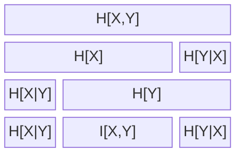

# Mutual Information

Ref 1, p.57, 1.120

$$
I(X,Y) \equiv D_{KL}[p(x,y)||p(x) p(y)]
$$

Ref 2, figure 8.1, p. 140, 
Note, I have added H[X,Y] = H[X] + H[Y|X]. Presumably MacKay left it out to reduce redundancy (the relationship is implied at bottom).
I put it in to be more explicit.

## Curious Aside

p.140 8.12

$$
D_H[X,Y] \equiv H[X,Y] - I[X;Y]
$$

It is a distance metric and symmetric. MacKay sees no application of it, but I include it here as I find it curious.

# Reference:
1, Christopher Bishop, Pattern Recognition and Machine Learning
2, David Mackay, Information Theory, Inference, and Learning Algorithms.
