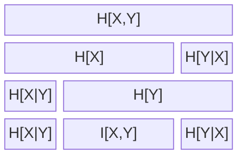

# Mutual Information

Ref 1, p.57, 1.120

$$
I(X,Y) \equiv D_{KL}[p(x,y)||p(x) p(y)]
$$

Ref 2, figure 8.1, p. 140, 
Note, I have added H[X,Y] = H[X] + H[Y|X]. Presumably MacKay left it out to reduce redundancy (the relationship is implied at bottom).
I put it in to be more explicit.

## Relationship between Mutual Information and $D_{KL}$

$$
I[Y,Y] = E_{x \sim p(x)}[E_{y \sim p(y|x)}[\frac{p(x) p(y|x)}{p(x) p(y)}]]
$$
$$
= E_{x \sim p(x)}[E_{y \sim p(y|x)}[\frac{p(y|x)}{p(y)}]]
$$

$$
= E_{x \sim p(x)}[D_{KL}[p(y|x)||p(y)]]
$$

## Upper Bound on Mutual Information

Introduding q(y) into fraction:

$$
I[X, Y]_p = E_{(x,y) \sim p(x,y)}[log(\frac{p(y|x) q(y)}{p(y) q(y)})]
$$

$$
= E_{(x,y) \sim p(x,y)}[log(\frac{p(y|x)}{q(y)})] + E_{(x,y) \sim p(x,y)}[\frac{q(y)}{p(y)}]
$$

$$
= E_{(x,y) \sim p(x,y)}[log(\frac{p(y|x)}{q(y)})] + E_{y \sim p(y)}[\frac{q(y)}{p(y)}]
$$

$$
= E_{(x,y) \sim p(x,y)}[log(\frac{p(y|x)}{q(y)})] - D_{KL}[q(y) \parallel p(y)]
$$

$$
I[X, Y]_p  \le E_{(x,y) \sim p(x,y)}[log(\frac{p(y|x)}{q(y)})]
$$

$$
I[X, Y]_p  \le E_{(x) \sim p(x)}[D_{KL}[p(y|x)|q(y)]]
$$

If q(y) matches the posterior p(y) closely then this is a tight bound. It may be easier to think of this as when there is little mutual information between X and Y, you can usefully upper bound this.

# Reference:
1, Christopher Bishop, Pattern Recognition and Machine Learning

2, David Mackay, Information Theory, Inference, and Learning Algorithms.

3, On Variational Bounds of Mutual Information (2019), Poole, Ozair, Van den Oord, Alemi, Tucker
[https://arxiv.org/pdf/1905.06922]
