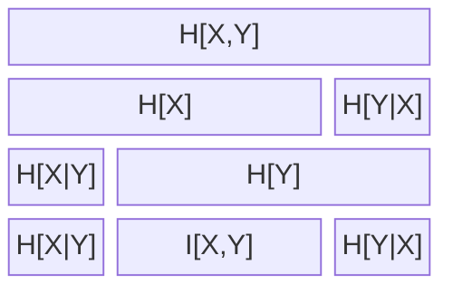

# Mutual Information

$$
I(X,Y) \equiv D_{KL}[p(x,y)||p(x) p(y)]
$$

figure 8.1, p. 140, 
Note, I have added H[X,Y] = H[X] + H[Y|X]. Am I correct to do so?

Reference:
David Mackay, Information Theory, Inference, and Learning Algorithms.
